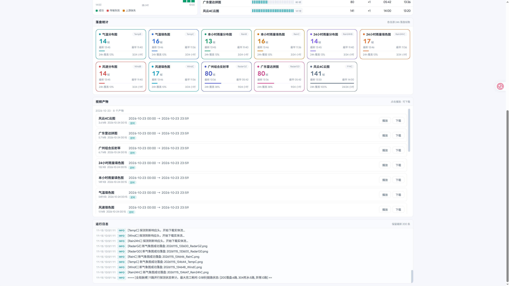

# 天气追踪边缘节点 (Weather Tracker Edge Node)




专为低功耗 x86 硬件（如 Intel i5-4200U）打造的 7x24 自动化气象数据采集与合成边缘节点。基于 ASGI（FastAPI + Uvicorn）无头运行，异步并发抓取广州气象台实况图/雷达回波、香港天文台雷达回波与中央气象台风云 4C（FY4C）云图，按需合成连贯 MP4 视频流，通过局域网 WebUI 提供控制与观测。

> 完整产品需求与技术架构见 [PRD.md](PRD.md)。

## 快速部署（Windows 10 IoT LTSC）

1. 环境还原：`uv sync`（需自备 `ffmpeg.exe`，本仓库不收录）
2. 放行端口（管理员 PowerShell）：`New-NetFirewallRule -DisplayName "Weather Tracker Edge Node" -Direction Inbound -Protocol TCP -LocalPort 11451 -Action Allow`
3. 启动（默认手动）：双击 `start_node.vbs`；需要开机自启时再执行 `deploy\configure_startup.ps1` 选择
4. 访问控制台：局域网浏览器打开 `http://<节点IP>:11451`

`data/`、`logs/` 由程序首次运行自动创建，无需手动准备。

## 启动方式（默认手动，不开机自启）

手动启动是默认方式，不会注册任何开机任务：

```powershell
# 默认手动：双击 start_node.vbs；或查看当前方式
.\deploy\configure_startup.ps1 -Mode status
```

需要开机自启时再显式选择：

```powershell
.\deploy\configure_startup.ps1           # 交互选择，直接回车 = 手动（默认）
.\deploy\configure_startup.ps1 -Mode auto    # 注册 SYSTEM 计划任务（需管理员）
.\deploy\configure_startup.ps1 -Mode manual  # 移除计划任务，回到手动（需管理员）
```

- 计划任务名：`WeatherTrackerEdgeNode`；`pythonw` 无窗口启动，异常退出 1 分钟后重试、最多 3 次。
- `deploy\install_task.ps1` / `uninstall_task.ps1` 是等价的底层脚本，一般直接用 `configure_startup.ps1` 即可。
- `deploy\watchdog.ps1` 探测 `/api/health`，失败时重启计划任务；可选，自行注册为每 5 分钟运行一次。
- 健康检查：`http://<节点IP>:11451/api/health`。启动 180 秒内、或仍有信源未完成首轮采集（最长 10 分钟）时返回 `starting`；之后任一信源 10 分钟未完成 tick 返回 HTTP 503 / `degraded`。

## 开发与测试

```powershell
uv sync                     # 含 pytest / ruff 开发依赖
uv run ruff check .         # 静态检查
uv run pytest               # 单元测试；本机有 ffmpeg.exe 时会额外跑一次合成集成测试
```

若本机 uv 配置的 PyPI 镜像暂时不可用（例如返回 403），可加 `--frozen` 跳过索引重新解析：
`uv run --frozen pytest`。

测试不访问网络，也不需要真实的 `data/` 数据；CI 在 Windows runner 上执行同样的命令。


## 运维速查

- 每日 00:15（进程在线时）自动合成昨日全天 7 个信源 24h 跨度视频（HKO 雷达仅保留约 5 小时，不参与 24h 总结） → `data/output/cron/`；启动时不补跑错过的时间点
- 存储 GC：原始图片保留 7 天，MP4 保留 30 天
- 首次 FY4C 回补：启动先补最近 24 小时，再按上游实际保留深度自适应延伸到目标 48 小时；运行期每 6 小时重扫一次历史缺口
- 雷达缺口自愈：广州/广东雷达启动及每 30 分钟扫描最近 20 小时；HKO 雷达扫描最近 4 小时（上游原始 URL 实测保留约 4 小时 48 分钟）。时次成熟 6 分钟后才探测，避免发布前反复 404
- 终止进程：根目录下 `stop_node.bat` 或 `taskkill /f /im pythonw.exe`
- 健康检查：`GET /api/health`；启动方式与看门狗用法见上方“启动方式”
- 台式机 → 笔记本手动同步清单见 [PRD.md](PRD.md) 5.4

## 协议与授权

## 字体

WebUI 自托管 [Google Sans Flex](https://github.com/googlefonts/googlesans-flex) 与 Noto Sans SC 子集，均为 SIL Open Font License 1.1；字体与许可证位于 [src/static/fonts](src/static/fonts)，不依赖公网字体 CDN。

代码以 [MIT License](LICENSE) 开源；本项目仅作气象数据的边缘采集与计算技术验证，所有气象数据版权归原发布机构所有。
