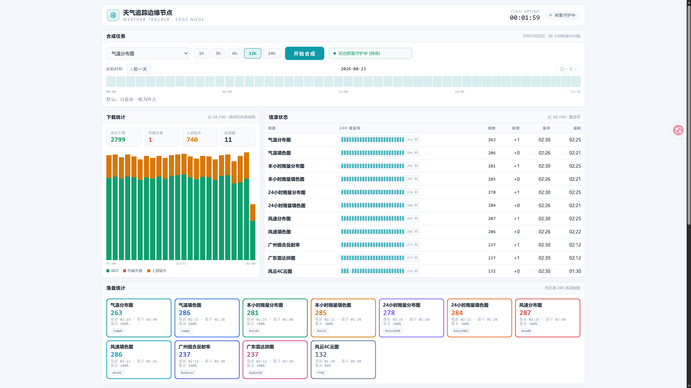

# 天气追踪边缘节点 (Weather Tracker Edge Node)




专为低功耗 x86 硬件（如 Intel i5-4200U）打造的 7x24 自动化气象数据采集与合成边缘节点。基于 ASGI（FastAPI + Uvicorn）无头运行，异步并发抓取广州气象台实况图/雷达回波与中央气象台风云 4C（FY4C）云图，按需合成连贯 MP4 视频流，通过局域网 WebUI 提供控制与观测。

> 完整产品需求与技术架构见 [PRD.md](PRD.md)。

## 快速部署（Windows 10 IoT LTSC）

1. 环境还原：`uv sync`（需自备 `ffmpeg.exe`，本仓库不收录）
2. 放行端口（管理员 PowerShell）：`New-NetFirewallRule -DisplayName "Weather Tracker Edge Node" -Direction Inbound -Protocol TCP -LocalPort 11451 -Action Allow`
3. 后台启动：双击 `start_node.vbs`
4. 访问控制台：局域网浏览器打开 `http://<节点IP>:11451`

`data/`、`logs/` 由程序首次运行自动创建，无需手动准备。

## 开发与测试

```powershell
uv sync                     # 含 pytest / ruff 开发依赖
uv run ruff check .         # 静态检查
uv run pytest               # 单元测试；本机有 ffmpeg.exe 时会额外跑一次合成集成测试
```

若本机 uv 配置的 PyPI 镜像暂时不可用（例如返回 403），可加 `--frozen` 跳过索引重新解析：
`uv run --frozen pytest`。

测试不访问网络，也不需要真实的 `data/` 数据；CI 在 Windows runner 上执行同样的命令。


## 运维速查

- 每日 00:15（进程在线时）自动合成昨日全天 7 个信源 24h 跨度视频 → `data/output/cron/`；启动时不补跑错过的时间点
- 存储 GC：原始图片保留 7 天，MP4 保留 30 天
- 首次 FY4C 回补：启动先补最近 24 小时，再按上游实际保留深度自适应延伸到目标 48 小时；运行期每 6 小时重扫一次历史缺口
- 雷达缺口自愈：启动及每 30 分钟扫描最近 6 小时，时次成熟 6 分钟后才探测，避免发布前反复 404
- 终止进程：根目录下 `stop_node.bat` 或 `taskkill /f /im pythonw.exe`
- 台式机 → 笔记本手动同步清单见 [PRD.md](PRD.md) 5.4

## 协议与授权

代码以 [MIT License](LICENSE) 开源；本项目仅作气象数据的边缘采集与计算技术验证，所有气象数据版权归原发布机构所有。
